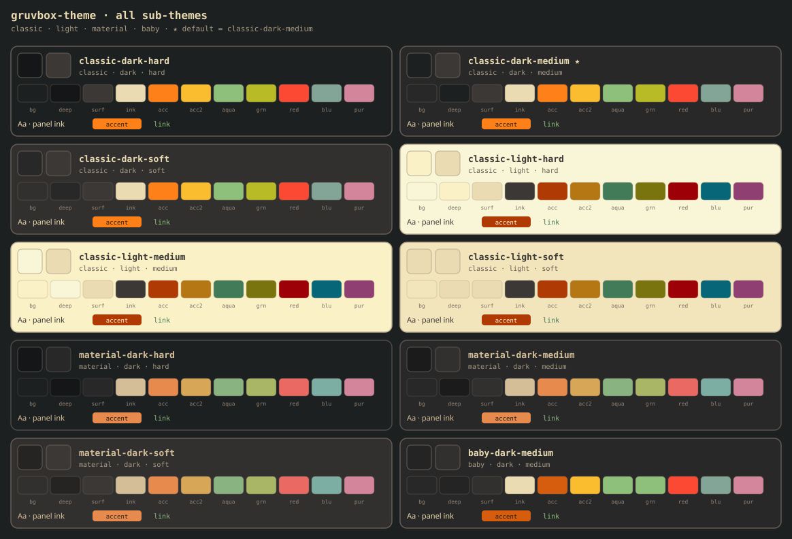

<div align="center">

**🌐 作者 [Sai](https://saaaai.com) · 個人サイト [saaaai.com](https://saaaai.com)** — AI ワークフローとオープンソース

**[English](README.md) · [简体中文](README.zh-CN.md) · [日本語](README.ja.md)**

</div>

# gruvbox-theme


**Gruvbox カラートークン + UI 配色ガイド + Claude/Agent skill**  
hex を探し回るのも、テキスト / ボタン / カードの色を勘で決めるのも、もう終わり。

デフォルトテーマ：**classic-dark-medium**  
ページ背景 `#282828` · 本文 `#ebdbb2` · アクセント橙 `#fe8019` · リンク青緑 `#8ec07c`

---

## 全サブテーマ一覧



インタラクティブ比較壁：[preview/index.html](preview/index.html) · コンパクト色見本：[docs/swatch-hint.svg](docs/swatch-hint.svg)

---

## このリポジトリの内容 / 内容でないもの

| 含まれる | 含まれない（意図的に作らない） |
|----------|--------------------------------|
| 公式絶対色表 + 10 セットのセマンティック JSON | 完全な React/Vue コンポーネントライブラリ |
| そのまま使える CSS 変数 | ブランドフォント / イラスト規約 |
| **実 UI での配色手順書** → [docs/usage.md](docs/usage.md) | Everforest など「似ているけど gruvbox ではない」混ぜ合わせ |
| AI エージェント向け `SKILL.md` 適用手順 | ターミナル専用テーマインストーラー（hex は流用可） |

要するに：**パレット契約 + 配色ガイド**。もう一つの UI kit ではありません。

---

## コンポーネントの配色（要約）

完全版は **[docs/usage.md](docs/usage.md)**（英語 [usage.en.md](docs/usage.en.md)）を参照。

| 部位 | 使うトークン |
|------|--------------|
| ページ背景 | `--bg`（より深いサイドバー / コード背景 → `--bg-deep`） |
| カード / ダイアログ | `--surface` + 枠線 `--border` |
| 本文 | `--ink` |
| 説明 / 補助 | `--ink-muted` · プレースホルダ `--ink-dim` |
| 主ボタン | `--accent` 背景 + `--on-accent` 文字（領域ごとに主 CTA は 1 つ） |
| 副ボタン / ゴースト | `--surface-2` または透明 + `--border` |
| リンク | `--link`（青緑。**主ボタンの橙と被らせない**） |
| エラー / 危険 | `--red`（文字・枠線。大きな塗り潰しは控える） |
| 成功ドット | `--green` · 警告 `--accent-2` |

**アンチパターン**：冷たいグレーの slate で作った偽ダーク、半透明の白文字本文、リンクもボタンも全部橙、大面积の純黒 / 純白。

---

## クイックスタート

### 人間：デフォルトのダークのみ

```html
<link rel="stylesheet" href="css/default.css" />
<body class="gruvbox-apply">
  <div class="panel" style="padding:16px;margin:24px;max-width:420px">
    <h1 style="margin:0 0 8px">パネルタイトル</h1>
    <p style="color:var(--ink-muted)">補足説明</p>
    <button class="btn-primary" type="button">メイン操作</button>
    <p><a href="#">リンク</a></p>
  </div>
</body>
```

### 人間：複数テーマ切替

```html
<link rel="stylesheet" href="css/all.css" />
<html data-theme="classic-dark-hard" class="gruvbox-apply">
```

有効な `data-theme` は下のサブテーマ表を参照。

### Claude Code / Agent

```bash
git clone https://github.com/nakamotosai/gruvbox-theme.git ~/.claude/skills/gruvbox-theme
```

そしてこう頼む：「このパネルを gruvbox テーマで変更して」または  
`Apply gruvbox-theme classic-dark-medium to this app`。

Agent は `SKILL.md` → `tokens/semantic/<id>.json` → [docs/usage.md](docs/usage.md) の順に読み、トークンをコンポーネントへ適用します。**hex の捏造は禁止**。

---

## サブテーマ

| id | 説明 |
|----|------|
| `classic-dark-medium` | **デフォルト** · 公式 medium |
| `classic-dark-hard` | より深い背景 `#1d2021` |
| `classic-dark-soft` | やや浅い背景 `#32302f` |
| `classic-light-*` | クリーム紙の背景 + 落ち着いたアクセント |
| `material-dark-*` | sainnhe Material の柔らかいアクセント |
| `baby-dark-medium` | gruvbox-baby 風 chrome |

コントラスト（hard/medium/soft）は**主に背景の深さを変える**もの。classic ダークのアクセントは引き続き明るい橙 / 青緑など。

---

## ディレクトリ構成

```
SKILL.md                      # Agent エントリ
tokens/
  absolute.json               # 公式絶対色
  index.json                  # 目録とデフォルト id
  semantic/*.json             # テーマごとのセマンティック色
css/
  default.css                 # 最速：デフォルトテーマ
  all.css                     # 全テーマ + ベース chrome
  absolute.css | themes.css | apply.css
docs/
  usage.md · usage.en.md      # コンポーネント配色ガイド
  compare.svg                 # README 用の全テーマ壁
  swatch-hint.svg             # コンパクト色見本
preview/index.html            # クリックできる比較壁
scripts/                      # トークン / プレビュー / アサーション生成
references/                   # 調査メモ
assets/readme/hero.svg        # README 冒頭 hero
README.md                     # English（デフォルト）
README.zh-CN.md               # 简体中文
README.ja.md                  # 本ファイル（日本語）
```

---

## 検証

```bash
python scripts/build_tokens.py
python scripts/build_preview_svg.py
python scripts/assert_tokens.py
```

ブラウザで `preview/index.html` を開くか、README 内の `docs/compare.svg` を確認してください。

---

## 謝辞

- [morhetz/gruvbox](https://github.com/morhetz/gruvbox) — 定番パレット（MIT/X11）
- [sainnhe/gruvbox-material](https://github.com/sainnhe/gruvbox-material) — Material アクセント（MIT）
- [luisiacc/gruvbox-baby](https://github.com/luisiacc/gruvbox-baby) — Baby 参考

## ライセンス

本リポジトリのパッケージングと skill テキストは **MIT**。上流パレットはそれぞれのライセンスに従います（`LICENSE` 参照）。

## 関連

- [sai-harness](https://github.com/nakamotosai/sai-harness) — 個人用 Claude Code ツールチェーン備忘録
- サイト：[saaaai.com](https://saaaai.com)
