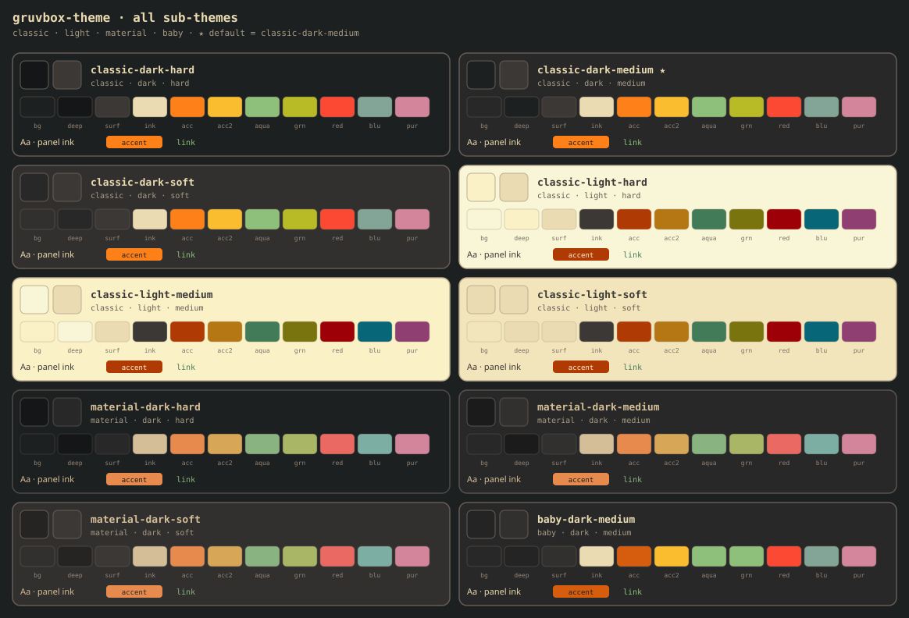

<div align="center">

**🌐 Made by [Sai](https://saaaai.com) · [saaaai.com](https://saaaai.com)** — AI workflow · one homepage

**[English](README.md) · [简体中文](README.zh-CN.md) · [日本語](README.ja.md)**

</div>

# gruvbox-theme


**Gruvbox color tokens + UI pairing guide + Claude/agent skill**  
Stop hunting hex codes — and stop guessing which color goes on text, buttons, and cards.

Default: **classic-dark-medium**  
bg `#282828` · ink `#ebdbb2` · accent `#fe8019` · link/aqua `#8ec07c`

### All sub-themes at a glance



Interactive wall: [preview/index.html](preview/index.html) · compact strip: [docs/swatch-hint.svg](docs/swatch-hint.svg)

---

## What this is / is not

| Ships | Does not ship |
|-------|----------------|
| Official absolute palette + 10 semantic JSON packs | Full React/Vue component library |
| Drop-in CSS variables | Brand fonts / illustration rules |
| **How to pair colors on real UI** → [docs/usage.en.md](docs/usage.en.md) | Everforest-style "almost gruvbox" mashups |
| `SKILL.md` apply steps for AI agents | Terminal-only installers (hex still reusable) |

Palette contract + pairing guide — not another UI kit.

---

## Component pairing (summary)

Full guide: **[docs/usage.en.md](docs/usage.en.md)** (中文 [usage.md](docs/usage.md)).

| UI part | Token |
|---------|-------|
| Page background | `--bg` (deeper chrome / code → `--bg-deep`) |
| Cards / dialogs | `--surface` + border `--border` |
| Body text | `--ink` |
| Meta / secondary | `--ink-muted` · placeholders `--ink-dim` |
| Primary button | `--accent` fill + `--on-accent` text (one CTA per region) |
| Secondary / ghost | `--surface-2` or transparent + `--border` |
| Links | `--link` (aqua — **not** the same orange as primary) |
| Error / danger | `--red` (copy/stroke; avoid huge solid red blocks) |
| Success dot | `--green` · warning `--accent-2` |

**Anti-patterns:** cool slate fake-dark, translucent white body text, orange for buttons *and* links *and* selection, pure black/white flats.

---

## Quick start (human)

Default dark only:

```html
<link rel="stylesheet" href="css/default.css" />
<body class="gruvbox-apply">
  <div class="panel" style="padding:16px;margin:24px;max-width:420px">
    <h1 style="margin:0 0 8px">Panel title</h1>
    <p style="color:var(--ink-muted)">Secondary copy</p>
    <button class="btn-primary" type="button">Primary</button>
    <p><a href="#">Link</a></p>
  </div>
</body>
```

Multi-variant:

```html
<link rel="stylesheet" href="css/all.css" />
<html data-theme="classic-dark-hard" class="gruvbox-apply">
```

Valid `data-theme` values: see the sub-themes table below.

---

## Quick start (Claude Code agent)

```bash
git clone https://github.com/nakamotosai/gruvbox-theme.git ~/.claude/skills/gruvbox-theme
```

Then: *"Apply gruvbox-theme classic-dark-medium to this app"* / *"用 gruvbox 主题改这个面板"*.

The skill reads `SKILL.md` → `tokens/semantic/<id>.json` → maps tokens per [docs/usage.en.md](docs/usage.en.md) — **no invented hex**.

---

## Sub-themes

| id | notes |
|----|--------|
| `classic-dark-medium` | **Default** · official medium |
| `classic-dark-hard` | bg0 `#1d2021` |
| `classic-dark-soft` | bg0 `#32302f` |
| `classic-light-*` | cream paper + faded accents |
| `material-dark-*` | sainnhe Material accents (softer) |
| `baby-dark-medium` | gruvbox-baby chrome |

Contrast mainly changes background depth; classic dark accents stay bright orange/aqua/etc.

---

## Layout

```
SKILL.md                      # agent entry
tokens/
  absolute.json               # official absolute colors
  index.json                  # catalog + default id
  semantic/*.json             # per-theme semantic colors
css/
  default.css                 # fastest: default theme
  all.css                     # all themes + base chrome
  absolute.css | themes.css | apply.css
docs/
  usage.md · usage.en.md      # component pairing guide
  compare.svg                 # full-theme wall for README
  swatch-hint.svg             # compact strip
preview/index.html            # clickable comparison wall
scripts/                      # token / preview / assertion generators
references/                   # research notes
assets/readme/hero.svg        # README hero banner
README.md                     # English (default)
README.zh-CN.md               # 简体中文
README.ja.md                  # 日本語
```

---

## Verify

```bash
python scripts/build_tokens.py
python scripts/build_preview_svg.py
python scripts/assert_tokens.py
```

Open `preview/index.html` in a browser, or check `docs/compare.svg` in the README.

---

## Credits

- [morhetz/gruvbox](https://github.com/morhetz/gruvbox) — classic palette (MIT/X11)
- [sainnhe/gruvbox-material](https://github.com/sainnhe/gruvbox-material) — material accents (MIT)
- [luisiacc/gruvbox-baby](https://github.com/luisiacc/gruvbox-baby) — baby reference

## License

MIT for this packaging and skill text. Upstream palettes keep their licenses (see `LICENSE`).

## Related

- [sai-harness](https://github.com/nakamotosai/sai-harness) — personal Claude Code toolchain notes
- [saaaai.com](https://saaaai.com)
