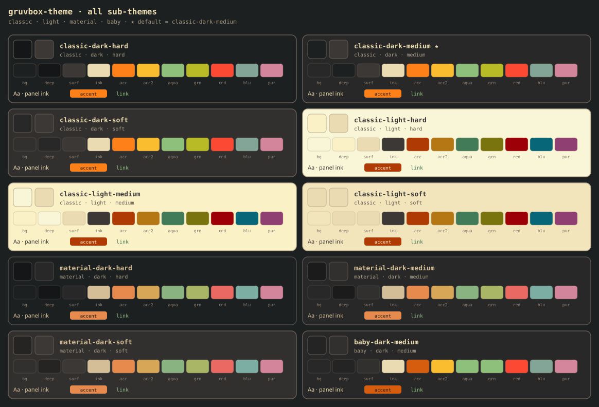

<div align="center">

**🌐 作者 [Sai](https://saaaai.com) · 个人主页 [saaaai.com](https://saaaai.com)** — AI 工作流与开源

**[English](README.md) · [简体中文](README.zh-CN.md) · [日本語](README.ja.md)**

</div>

# gruvbox-theme


**Gruvbox 色板令牌 + 组件搭配说明 + Claude/Agent skill**  
不用再满世界搜 hex，也不用凭感觉乱配文字 / 按钮 / 卡片。

默认主题：**classic-dark-medium**  
页面底 `#282828` · 正文 `#ebdbb2` · 主强调橙 `#fe8019` · 链接青绿 `#8ec07c`

---

## 十种子主题一览



交互对照墙：[preview/index.html](preview/index.html) · 紧凑色条：[docs/swatch-hint.svg](docs/swatch-hint.svg)

---

## 仓库里有什么 / 没有什么

| 有 | 没有（故意不做） |
|----|------------------|
| 官方绝对色表 + 10 套语义 JSON | 完整 React/Vue 组件库 |
| 可直接引用的 CSS 变量 | 品牌字体 / 插画规范 |
| **组件怎么配色的说明书** → [docs/usage.md](docs/usage.md) | 和 Everforest 等「像但不算 gruvbox」的混搭 |
| 给 AI 用的 `SKILL.md` 接线步骤 | 终端专用 theme 安装包（hex 仍可复用） |

简单说：**色板合同 + 搭配教程**，不是另一套 UI kit。

---

## 组件怎么配（摘要）

完整版请看 **[docs/usage.md](docs/usage.md)**（英文 [usage.en.md](docs/usage.en.md)）。

| 部位 | 用哪个令牌 |
|------|------------|
| 页面背景 | `--bg`（更深侧栏 / 代码底 → `--bg-deep`） |
| 卡片 / 弹窗 | `--surface` + 边 `--border` |
| 正文 | `--ink` |
| 说明 / 次要 | `--ink-muted` · 占位 `--ink-dim` |
| 主按钮 | `--accent` 底 + `--on-accent` 字（一区一个主 CTA） |
| 次按钮 / 幽灵 | `--surface-2` 或透明 + `--border` |
| 链接 | `--link`（青绿，**别**和主按钮抢橙色） |
| 错误 / 危险 | `--red`（文案、描边；少做大红实心块） |
| 成功点 | `--green` · 警告 `--accent-2` |

**反模式**：冷灰 slate 假深色、正文半透明白字、链接和按钮全上橙色、大面积纯黑/纯白。

---

## 快速上手

### 人类：只上默认暗色

```html
<link rel="stylesheet" href="css/default.css" />
<body class="gruvbox-apply">
  <div class="panel" style="padding:16px;margin:24px;max-width:420px">
    <h1 style="margin:0 0 8px">面板标题</h1>
    <p style="color:var(--ink-muted)">次要说明</p>
    <button class="btn-primary" type="button">主操作</button>
    <p><a href="#">链接</a></p>
  </div>
</body>
```

### 人类：多主题切换

```html
<link rel="stylesheet" href="css/all.css" />
<html data-theme="classic-dark-hard" class="gruvbox-apply">
```

合法 `data-theme` 见下方子主题表。

### Claude Code / Agent

```bash
git clone https://github.com/nakamotosai/gruvbox-theme.git ~/.claude/skills/gruvbox-theme
```

然后说：「用 gruvbox 主题改这个面板」或  
`Apply gruvbox-theme classic-dark-medium to this app`。

Agent 会读 `SKILL.md` → `tokens/semantic/<id>.json` → 按 [docs/usage.md](docs/usage.md) 把令牌接到组件，**禁止瞎编 hex**。

---

## 子主题

| id | 说明 |
|----|------|
| `classic-dark-medium` | **默认** · 官方 medium |
| `classic-dark-hard` | 更深底 `#1d2021` |
| `classic-dark-soft` | 略浅底 `#32302f` |
| `classic-light-*` | 奶油纸底 + 褪色强调色 |
| `material-dark-*` | sainnhe Material 柔和强调色 |
| `baby-dark-medium` | gruvbox-baby 风格 chrome |

对比度（hard/medium/soft）**主要换背景深度**；classic 暗色强调色仍是 bright 橙 / 青等。

---

## 目录

```
SKILL.md                      # Agent 入口
tokens/
  absolute.json               # 官方绝对色
  index.json                  # 目录与默认 id
  semantic/*.json             # 每套主题的语义色
css/
  default.css                 # 最快：默认主题
  all.css                     # 全部主题 + 基础 chrome
  absolute.css | themes.css | apply.css
docs/
  usage.md · usage.en.md      # 组件搭配说明书
  compare.svg                 # README 全主题墙
  swatch-hint.svg             # 紧凑色条
preview/index.html            # 可点对照墙
scripts/                      # 生成 token / 预览 / 断言
references/                   # 研究笔记
assets/readme/hero.svg        # README 首屏 hero
README.md                     # English（默认）
README.zh-CN.md               # 本文件（简体中文）
README.ja.md                  # 日本語
```

---

## 校验

```bash
python scripts/build_tokens.py
python scripts/build_preview_svg.py
python scripts/assert_tokens.py
```

浏览器打开 `preview/index.html`，或直接看 README 里的 `docs/compare.svg`。

---

## 致谢

- [morhetz/gruvbox](https://github.com/morhetz/gruvbox) — 经典色板（MIT/X11）
- [sainnhe/gruvbox-material](https://github.com/sainnhe/gruvbox-material) — Material 强调色（MIT）
- [luisiacc/gruvbox-baby](https://github.com/luisiacc/gruvbox-baby) — Baby 参考

## 许可

本仓库打包与 skill 文本为 **MIT**。上游色板仍遵循各自许可（见 `LICENSE`）。

## 相关

- [sai-harness](https://github.com/nakamotosai/sai-harness) — 个人 Claude Code 工具链笔记  
- 站点：[saaaai.com](https://saaaai.com)
